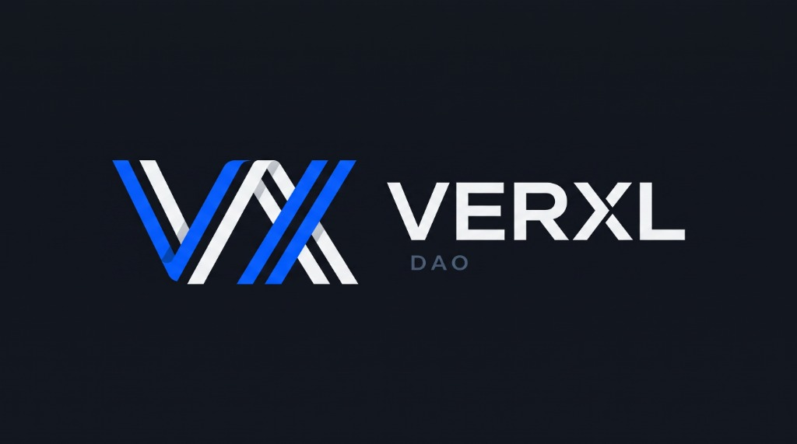

# Verxl Protocol (`verxl.com`)
### Non-Custodial AI Inference Clearing & Decentralized Compute Marketplace

[](https://verxl.com)
[](https://verxl.com/whitepaper)
[](https://sepolia.etherscan.io/address/0xf0e51fB0FFBD8ef36281b6f643E0f7953BD5111a)
[](https://app.aragon.org/dao/ethereum-sepolia/0xf0e51fB0FFBD8ef36281b6f643E0f7953BD5111a/proposals/VIP-1)
[](contracts/test/VerxlStakingRegistry.test.cjs)
[](LICENSE)



> [!NOTE]
> **Academic Test Run Notice:** Project Verxl Protocol is currently deployed as an academic proof-of-concept test run on the **Ethereum Sepolia testnet** and **Cloudflare Pages** for Course 4KE404 / 4KE505 Crypto at the Faculty of International Relations (FIR / FMV), Prague University of Economics and Business (VŠE Praha). All on-chain smart contracts, DAO vaults, and telemetry operate in a testnet demonstration environment.

---

## Executive Summary

**Verxl Protocol** is an open, non-custodial clearinghouse and edge routing layer for artificial intelligence inference. Governed on-chain by **Verxl DAO** via Aragon OSx, the protocol directly connects enterprise AI consumers with verified, independent GPU cluster operators.

### The Problem: Intermediary Deadweight Loss
Centralized AI aggregators operate as principal broker-dealers, reselling wholesale compute at retail markups between **840 and 1,040 basis points** (8.4%–10.4%). Furthermore, they mandate unsegregated custodial balances (forcing users to fund unsecured broker debt) and face moral hazard to secretly route requests to 4-bit quantized models on depreciated hardware (Akerlof lemons problem).

### The Solution: Non-Custodial Agency Clearing
* **50 bps Protocol Fee:** An ultra-thin 0.50% fee switch accrued directly to the on-chain DAO treasury vault.
* **Surety Bonding & Slashing:** Compute operators post $VRXL collateral. Consecutive failed audits trigger automatic 10% slashing with 50% routed to the DAO vault and 50% burned.
* **Deterministic Canary Oracle:** Cryptographic seed-42 canary probes verify FP16 weight fidelity and token edit distance.
* **OpenAI SDK Drop-in Proxy:** Stateless `/v1/chat/completions` API proxy at the Cloudflare Edge with sub-50ms Time-to-First-Token (TTFT).

---

## 🏛️ Live On-Chain Deployments & DAO Governance

* **Primary Domain:** [`https://verxl.com`](https://verxl.com)
* **Direct Whitepaper Web Route:** [`https://verxl.com/whitepaper`](https://verxl.com/whitepaper)
* **Raw Markdown Whitepaper:** [`https://verxl.com/whitepaper.md`](https://verxl.com/whitepaper.md)
* **DAO Contract Vault (Sepolia):** [`0xf0e51fB0FFBD8ef36281b6f643E0f7953BD5111a`](https://sepolia.etherscan.io/address/0xf0e51fB0FFBD8ef36281b6f643E0f7953BD5111a)
* **Aragon OSx Dashboard:** [Verxl DAO on Aragon App](https://app.aragon.org/#/daos/sepolia/0xf0e51fB0FFBD8ef36281b6f643E0f7953BD5111a)
* **Live Governance Proposal (VIP-1):** [VIP-1 On-Chain Voting Proposal](https://app.aragon.org/dao/ethereum-sepolia/0xf0e51fB0FFBD8ef36281b6f643E0f7953BD5111a/proposals/VIP-1)
* **Execution Transaction Hash:** [`0x247d5d5b5fca30b1cfadc102322a22001e6c828e41705aafe1bb54e23921b6b6`](https://sepolia.etherscan.io/tx/0x247d5d5b5fca30b1cfadc102322a22001e6c828e41705aafe1bb54e23921b6b6)
* **Governance Token:** `$VRXL` (Fixed 1,000,000 genesis supply; 20% circulating quorum; 50% majority threshold)

---

## 📚 Academic Course Context (FIR VŠE Prague)

* **Institution:** Prague University of Economics and Business (VŠE Praha)
* **Faculty:** Faculty of International Relations (FIR / FMV)
* **Course:** 4KE404 / 4KE505 Crypto (Winter Semester 2026/2027)
* **Instructor:** Ing. Ondřej Paruch
* **Lead Architect:** Šimon Havlík

### Task 1: Aragon DAO Deployment (Graded 2 + 1 APs)
1. **Live DAO Contract:** [`0xf0e51fB0FFBD8ef36281b6f643E0f7953BD5111a`](https://sepolia.etherscan.io/address/0xf0e51fB0FFBD8ef36281b6f643E0f7953BD5111a)
2. **Submission Guide & Checklist:** [`docs/ARAGON_SEPOLIA_DEPLOYMENT_GUIDE.md`](docs/ARAGON_SEPOLIA_DEPLOYMENT_GUIDE.md)
3. **Extra Credit Deliverable (+1 AP): Founders' Agreement:** [`docs/FOUNDERS_AGREEMENT.md`](docs/FOUNDERS_AGREEMENT.md)
4. **Extra Credit Deliverable (+1 AP): Programmatic Deployment Script:** [`contracts/scripts/deploy-dao.js`](contracts/scripts/deploy-dao.js)

### Task 2: Term Project Pitch & Presentation (Graded 8 APs)
* **Pitch Presentation Date:** November 4, 2026 | xPort VŠE (Jeseniova 2769/208, Praha 3)
* **Strict Time Limit:** Exactly 5 minutes
* **Official Institutional Whitepaper:** [`docs/WHITEPAPER.md`](docs/WHITEPAPER.md)
* **8-Slide Presentation Deck:** [`docs/PRESENTATION_PITCH_DECK.md`](docs/PRESENTATION_PITCH_DECK.md)
* **Word-for-Word Pitch Script:** [`docs/PRESENTATION_PITCH_SCRIPT.md`](docs/PRESENTATION_PITCH_SCRIPT.md)

---

## ⚙️ Monorepo Architecture

```
verxl-protocol/
├── assets/                     # Brand identity (horizontal and square logos)
├── contracts/                  # Solidity 0.8.20 contracts & Hardhat test suite
│   ├── contracts/
│   │   ├── VerxlToken.sol      # $VRXL ERC-20 fixed-supply governance token
│   │   └── VerxlStakingRegistry.sol # Collateral bonding, slashing, & cooldowns
│   ├── scripts/
│   │   ├── deploy-contracts.js # Hardhat contract deployment pipeline
│   │   └── deploy-dao.js       # Aragon OSx SDK programmatic DAO setup
│   └── test/
│       └── VerxlStakingRegistry.test.cjs # 9/9 Hardhat unit tests (100% passing)
├── database/                   # PostgreSQL relational telemetry DDL
│   ├── schema.sql              # Clean DDL (users, api_keys, providers, audits, usage)
│   └── seed.sql                # Staging canary verification data
├── docs/                       # Academic submissions & institutional documentation
│   ├── WHITEPAPER.md           # Core institutional specification
│   ├── WHITEPAPER_DETAILED.md  # Extended theoretical mechanism design
│   ├── FOUNDERS_AGREEMENT.md   # Founding member governance charter
│   ├── PRESENTATION_PITCH_DECK.md # 8-slide presentation deck
│   ├── PRESENTATION_PITCH_SCRIPT.md # 5-minute timed script
│   └── ARAGON_SEPOLIA_DEPLOYMENT_GUIDE.md # DAO deployment audit trail
├── functions/                  # Cloudflare Pages Edge Functions
│   ├── v1/
│   │   ├── chat/completions.ts # OpenAI SDK drop-in streaming endpoint
│   │   └── models.ts           # OpenAI standard model registry
│   └── api/
│       ├── audit.ts            # Deterministic canary probe runner
│       ├── health.ts           # Edge telemetry & Sepolia health check
│       └── providers.ts        # Dynamic GPU fleet discovery endpoint
├── public/                     # Static production assets, _headers, & _redirects
├── src/                        # React 18 + TypeScript + Three.js web application
│   ├── components/             # Institutional terminal components (0 rounded buttons)
│   │   ├── Header.tsx          # Sticky header with Sepolia Test Run top bar
│   │   ├── Hero.tsx            # Three.js 3D constellation & interactive demo window
│   │   ├── Playground.tsx      # Live OpenAI-compatible inference console
│   │   ├── Registry.tsx        # GPU provider staking & collateral manager
│   │   ├── Oracle.tsx          # Canary probe auditor & slashing history
│   │   ├── Governance.tsx      # Live Aragon OSx DAO proposal viewer
│   │   ├── Whitepaper.tsx      # In-browser publication reader & printer
│   │   └── Footer.tsx          # Academic attribution & network status
│   ├── data/mockData.ts        # Telemetry & provider mock datasets
│   └── index.css               # Electric blue terminal design system
├── wrangler.jsonc              # Cloudflare Pages configuration
└── vite.config.ts              # Multi-entry Vite bundler configuration
```

---

## 🚀 Quick Start & Development

### Prerequisites
* Node.js v18+ or v20+
* npm or pnpm

### 1. Clone & Install
```bash
git clone https://github.com/simonhavlik/verxl-protocol.git
cd verxl-protocol

# Install root dependencies (React, Three.js, Tailwind, Vite)
npm install

# Install smart contract dependencies (Hardhat, OpenZeppelin)
cd contracts && npm install && cd ..
```

### 2. Configure Environment (Optional)
```bash
cp .env.example .env
```
*(The repository is configured to safely default to public Sepolia RPCs and simulation fallbacks if zero environment variables are configured).*

### 3. Run Web Application Locally
```bash
npm run dev
```
Open [http://localhost:5173](http://localhost:5173) in your browser.

### 4. Run Smart Contract Test Suite
```bash
npm run test:contracts
```
```
  Verxl Protocol Smart Contracts
    VerxlToken Genesis Distribution
      ✔ Should allocate 250,000 $VRXL to each of the 4 founding members
    Provider Registration & Staking
      ✔ Should successfully register a GPU provider with sufficient stake
      ✔ Should reject registration if stake is below 1,000 $VRXL minimum
    Autonomous AI Quality Oracle Auditing & Slashing
      ✔ Should put a provider into PROBATION on first failed audit probe
      ✔ Should restore an audited provider to ACTIVE upon passing probe retest
      ✔ Should automatically slash 10% collateral and route 50% to DAO Vault upon consecutive failure
      ✔ Should disallow non-oracles from triggering audits or slashing
    Unbonding Period & Cooldown Enforcement
      ✔ Should prevent immediate withdrawal before the 24-hour unbonding period
      ✔ Should permit withdrawal after the 24-hour unbonding period has passed

  9 passing (623ms)
```

### 5. Build for Production
```bash
npm run test:all
```
Compiles TypeScript, packages multi-entry static HTML (`index.html`, `whitepaper.html`, `whitepaper/index.html`), and verifies contract test integrity.

---

## 🔒 Security & Best Practices

* **Zero Custodial Risk:** Verxl never retains consumer deposits or unsegregated balances on an intermediary balance sheet.
* **Strict Type Safety:** Fully typed in TypeScript 5.5 with zero `any` assertions in production paths.
* **SQL Injection & PHP Immunity:** Stateless edge routing with parameterized PostgreSQL schemas. Zero PHP runtime dependencies.
* **Clean Git Provenance:** Zero private keys, zero deployment tokens, and zero sensitive secrets are committed or stored in git history. All private tokens must be passed via environment variables.

---

## 📄 License

This project is licensed under the [MIT License](LICENSE) — see the [LICENSE](LICENSE) file for details.

Copyright (c) 2026 Šimon Havlík and Verxl Protocol Contributors.
Prague University of Economics and Business (VŠE Praha) • Faculty of International Relations (FIR).
